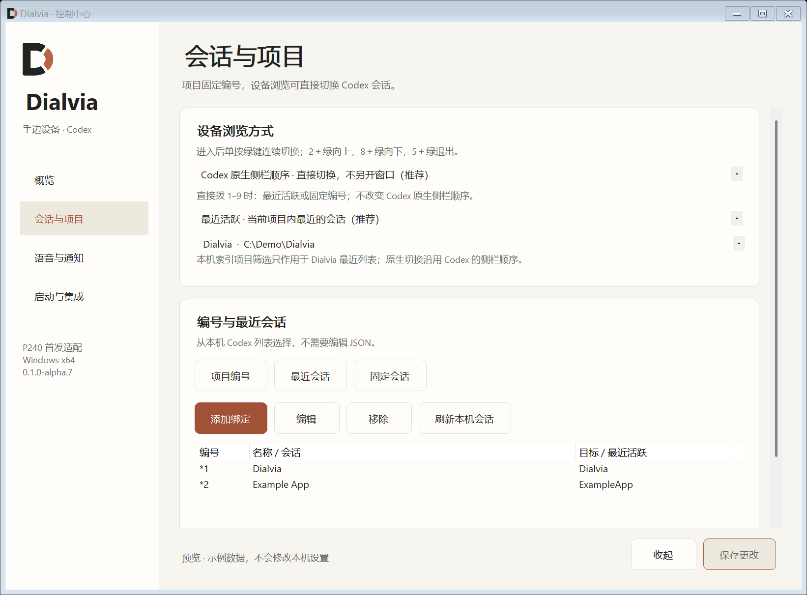

<p align="center"></p>
<h1 align="center">Dialvia</h1>
<p align="center">用手边的实体设备，操作 Windows 上的 Codex。</p>
<p align="center"><a href="README.md">English</a> · <a href="https://github.com/Octo-o-o-o/Dialvia/releases">下载 Windows 版</a></p>

Dialvia 把 USB 听筒上的拨号键、接听键和挂机键接到 Codex：按编号切换会话／项目，开启语音输入，接收任务完成提示。

**首个适配器是缤特力 Plantronics Calisto P240，目前只对这一个型号提供支持。** 名字不限定型号，代码保留 `IDeviceAdapter` 扩展接口；其他 Poly／Plantronics 设备、普通 HID 键盘等需要单独适配和实机测试。



日常配置使用图形界面；JSON 仅保留为高级入口。图中会话与项目均为虚构演示数据。

## 安装与首次配置

1. 安装 Windows 版 Codex，并单独安装 **Plantronics Hub**，插入 P240。开发设备使用 Hub 3.25.2。系统能播放／录音，并不意味着数字键的完整控制接口已启用。
2. 在 [Releases](https://github.com/Octo-o-o-o/Dialvia/releases) 下载并解压 Windows x64 包，从资源管理器运行 `Dialvia.exe`。程序依赖 Windows 的 .NET Framework 4.8 和 Hub，不需要额外安装 .NET SDK；Hub 安装包不随本项目分发。EXE 尚未数字签名。
3. 单击托盘图标打开控制中心，在 **会话与项目** 选择本机项目，按需固定项目编号。可从最近会话列表直接添加绑定，也能手动粘贴 `codex://threads/会话UUID`。公开包映射为空，默认处于检测模式。
4. 在 **语音与通知** 选择听写或实时语音；到 **启动与集成** 配置语音快捷键，再从概览或托盘菜单关闭检测模式。若新快捷键没有响应，等其他任务空闲再重开 Codex。
5. 如需登录自启，在 **启动与集成** 点击“安装并开启自启”，或运行 `Install.cmd`。以当前用户安装，不需要管理员权限。开始菜单新增 Dialvia 入口，托盘菜单也可开关自启。
6. 如需任务通知，先确定 EXE 的固定位置，再点“配置任务完成通知”，到 Codex 的 Hooks 管理中首次审阅并信任 **Dialvia task notification**。

托盘图标可能在 Windows 右下角“显示隐藏的图标”里。不要与此前的个人版 P240 控制器同时运行，两者都会申请 Hub 默认软电话。个人版仍保留在原处，可先退出它再试用 Dialvia；私有会话编号不会上传仓库。

## 按键

P240 先在话机内缓存数字，按绿色键才提交。它并非每按一个数字就立即切换。

| 操作 | 作用 |
|---|---|
| `1`–`9`＋绿色键 | 选择当前列表前九条最近会话；固定模式则打开固定会话，也支持 `#1`–`#9` |
| `*1`–`*9`＋绿色键 | 打开项目预设会话，也支持 `11`–`19` |
| `22` 或 `*#`＋绿色键 | 进入 Codex 原生会话切换，默认不另开窗口 |
| 浏览中 `2`／`8`＋绿色键 | 改为向上／向下，并切换一条会话 |
| `*`／`#`＋绿色键 | 上一项／下一项，也可直接进入切换模式 |
| 浏览中 `5`＋绿色键；任意时 `23`＋绿色键 | 退出切换，保留当前会话 |
| 浏览中只按绿色键 | 沿当前方向继续切换一条；可选弹窗模式则进入所选会话 |
| `0`＋绿色键 | 在当前聊天开启所选语音模式 |
| 空闲时只按绿色键 | 显示操作提示，不开始录音 |
| `00`＋绿色键 | 结束听写、等文字出现并检查后，明确发送当前 Codex 草稿 |
| 话机语音中按绿键，或 `*0`＋绿色键 | 停止该次语音；红键尽力响应 |
| `#0`＋绿色键 | 实时语音对话的麦克风静音切换 |
| 拨号时按红键 | 清空尚未提交的数字 |
| 原有音量／静音键 | 普通音频操作；通话中兼容模式的重叠情况见下文 |

项目编号指向已有会话，不会创建新的项目或会话。录音结束后再切换目标。控制器聚焦 Codex 时保留最大化状态，只对已最小化的窗口执行恢复。

完整听写流程：**`0＋绿键`开始 → 再按绿键（或 `*0＋绿键`）结束 → 等文字出现并检查 → `00＋绿键`发送。** 安装配置会为 Codex 专门的 `composer.submit` 命令绑定快捷键，默认 `Ctrl+Alt+Shift+F12`，不使用通用回车键。仍在录音、绑定缺失／禁用／冲突时拒绝发送；新绑定若未加载，需等其他任务空闲后重开 Codex。空草稿及当前不能发送的情况由 Codex 原生命令处理，已有任务的跟进方式也沿用 Codex 设置。

开始前先调用 Codex 原生 `focusMainChat`（默认 `Alt+L`），定位到主聊天输入框。空闲单按绿／红键不再开始录音。程序只读 Windows 的 Codex 麦克风活动记录，辅助识别已经停止的采集，避免再次切换把录音打开；该记录不是稳定公开的语音状态接口，也不能证明当前输入框已进入录音。记录缺失或无效时按未知处理，不读取音频。仍有状态差异时，可在语音设置／托盘使用“Codex 已停止：校正状态”，仅清除话机跟踪状态。

停止快捷键发出后继续保留“等待停止确认”；只有本次开始之后的停止时间才能清除状态。旧的未录音记录不会因等待两秒而提前清除新录音。快速重复停止会被抑制，稍后重试需确认麦克风仍在采集。快捷键按下／松开之间保留 80 毫秒，供 Windows 全局监听处理。

**P240 通话中接听键兼容：** 本机实测同一个绿键在空闲时为 raw 7（Talk），在话机通话中却为 raw 3（SDK 标成 VolumeUpHeld）。本版在本地通话及控制器语音都活跃时，将后者识别为停止；用户已确认开始、绿键停止和文字草稿正常。真实音量加键后的连续长按事件会被保护。若侧键只报告同一种独立信号，仍无法区分，可能误停；可在“语音与通知”关闭兼容开关。空闲 raw 3 不会启动语音。该规则只针对当前 P240／Hub 实测，不代表所有组合相同。

如果 Codex 界面已停止录音，控制器仍认为在录音，可在语音设置或托盘点击 **“Codex 已停止：校正状态”**。先确认界面状态，再校正；它只同步话机和控制器，不发送快捷键，避免错误地重新开启录音。

## 会话为什么不默认固定编号

推荐 **项目固定编号，设备浏览直接沿用 Codex 侧栏顺序**。原生模式调用本机的 `previousThread`／`nextThread` 命令，每次移动立即打开目标会话，不另开窗口，也不需要再次确认。程序尊重兼容的自定义快捷键，禁用或冲突时显示说明；默认配置不新增 Codex 快捷键，也无需为此重启 Codex。

连续切换时，先按一次 **`#＋绿键`**，之后每次**只按绿键**就向下切一条；用 `*＋绿键` 或 `2＋绿键` 改为向上，之后继续只按绿键。`22＋绿键` 默认向下进入但不移动。快速连按分别排队，不会被重置计时器合并成一次；退出会清空尚未执行的步进，避免误开语音。

浏览模式之外，直接拨 `1–9` 仍使用“最近活跃／固定编号”的设置。可选的 Dialvia 弹窗按项目内最近活跃排列，浏览中保持顺序，刷新或切换项目时才重新排序。标题旁显示今天／昨天／日期，无需按日期拨号。该项目筛选只作用于 Dialvia 本机列表，不改变 Codex 原生侧栏顺序。

可选弹窗支持键盘上／下选择会话，左／右切换项目，Enter 确认、Esc 收起。小米遥控器项目的调研与取舍见 [交互设计记录](docs/navigation.md)。本机 P240 的中央上下键没有可用输入；普通侧键继续调音量，无法区分的长按报告见上文兼容说明。alpha.1 已确认弹窗打开与下移正常，但空闲红键未能收起，因此请用 **`5＋绿键` 或 `23＋绿键`退出**。红键仅在收到对应按钮／通话状态时响应。

暂不支持 `*`、`#` 长按：当前可用接口只提交整串号码，缺少可靠的按下／松开时序。数字代码仍需绿色键提交；原生模式中的连续步进只需绿色键本身。

本机最近列表通过只读连接读取 Codex 索引中的 ID、标题、项目目录与活跃时间，最多 200 条未归档会话，不读取聊天正文。该索引并非稳定公开 API，格式变化时可退回手动会话链接。

## 语音使用什么服务

默认是 **Codex 自带的听写**：P240 提供麦克风，Codex 采集音频并用已登录账号的 ChatGPT/Codex 转写服务生成文字草稿，再由你确认发送。Dialvia 只发送开始／结束快捷键，不配置另一个 STT 服务，不需要额外 API Key。

本机检查到客户端使用 `/dictation/stream` 流式接口，没有公开确切的转写模型名称，因此不把它标为某个 Whisper 或 GPT 模型。实时语音对话是另一种 Codex 功能，其可用性受账号、版本和当前任务影响。详见 [语音说明](docs/voice.md) 与 [官方文档](https://learn.chatgpt.com/docs/features/voice)。

设置中的“选择 Windows 麦克风和声音输出”打开系统声音页。选择 P240 输入／输出后，仍以 Codex 自己选择的音频设备为优先；程序不强制更改全局默认设备。

## 通知

弹窗默认开启，听筒短铃默认关闭。可手动测试；检测模式及由 Dialvia 跟踪的语音期间不响铃。

任务完成通知使用异步 Stop hook：执行 `Dialvia.exe --notify`，把“Codex 已完成回复”写入本地短期队列。它无需 PowerShell 通知脚本，保留既有 `config.toml` 的 `notify` 配置。**首次 Hooks 审阅／信任仍需在 Codex 完成**，见 [官方 Hooks 说明](https://learn.chatgpt.com/docs/hooks)。

## 版本与验证边界

当前为 **0.1.0-alpha.7**。本版修复任务栏／标题栏的整枚铜色错误，EXE、快捷方式与窗口统一使用界面内的黑铜双色 D 标志，并增加 8 项实际 EXE 资源的 Windows 原生渲染检查。本版移除图标底板，扩大 D 形主体，并按 Windows 任务栏主题选择浅／深背景图标。45 个原生 ICO 帧和 3 个 SVG 检查通过；13 个演示界面状态在 Windows 150% 缩放下检查通过，覆盖四页设置、紧凑窗口、绑定编辑、会话列表空态及错误态。增加取消、保存状态、键盘操作和可访问名称，详见 [视觉与界面检查](docs/visual-design.md)。同一 P240 已确认：固定编号、听写开始、绿键停止并生成文字、原生会话切换及单绿键连续切换正常。98 项核心断言通过，覆盖校准到的两种绿键信号、音量长按序列、旧时间戳、停止等待、发送前聚焦及发送／绑定检查。首次发送测试已发出快捷键，但 Codex 没有提交；发送前聚焦已补齐，仍待重新载入新绑定、会话可提交时验收。GUI 使用演示数据做了布局检查。

完整实时语音、实际短铃、首次信任后的真实任务通知尚需实机验收；不宣称所有设备或所有语音模式都已通过。当前没有 Anyvia 产品接入，Anyvia 属于后续方向。见 [验证记录](docs/validation.md)。

## 开发

```powershell
git clone https://github.com/Octo-o-o-o/Dialvia.git
cd Dialvia
.\scripts\Test.ps1
.\scripts\Build.ps1
```

使用普通 Windows 终端和当前脚本执行策略，不需要修改系统安全设置。构建会从已安装的 `PlantronicsCOM.dll` 生成托管接口 DLL，和带图标的 EXE 一同打包。解压后请保留 EXE 与 `Interop.Plantronics.dll` 在同一目录。生成结果在 `dist`，详见 [构建说明](docs/build.md)。

配置及日志在 `%LOCALAPPDATA%\Dialvia`，通知队列在 `Documents\Codex\Dialvia\notifications`。运行 `Uninstall.cmd` 移除自启动及本程序拥有、且未被用户修改的快捷键／Hook，保留数据和 Hub。

## 名字与图标

Dialvia 的 “Dial” 对应拨号操作，“via” 对应进入现有工具的通路，也与 Anyvia 呼应。图标使用 Anyvia 的纸白、墨黑、铜色系统，重新设计开放的 D 形笔画，SVG、PNG 和多尺寸 ICO 同源构建，全部使用透明背景。D 形主体高度占画布约 92%，替代旧图标的约 57%；EXE／任务栏／标题栏与界面使用一致的黑铜双色主体，托盘分别使用适合浅／深色任务栏的墨黑／纸白主体，并提供 16–256 像素的 15 档原生尺寸。

代码与原创图标采用 [MIT](LICENSE)。这是独立社区项目，非 OpenAI、HP、Poly 或 Plantronics 官方软件。见 [第三方说明](THIRD-PARTY-NOTICES.md)。
