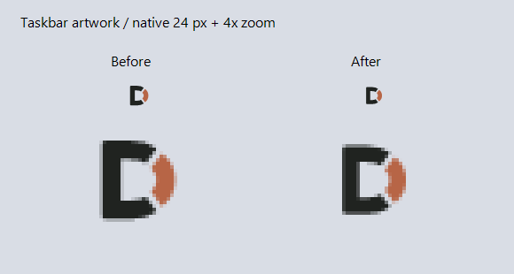
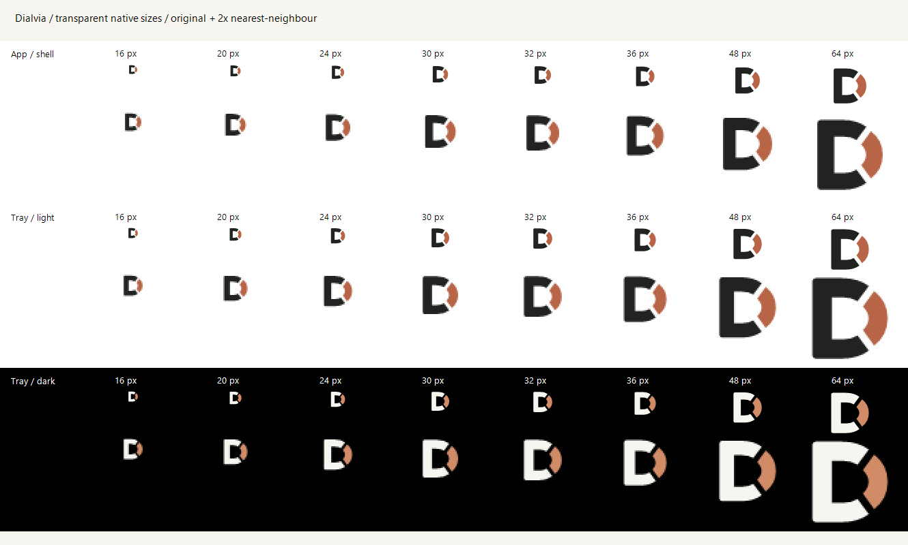

# Visual design and UI checks — alpha.9

The original D geometry and ink/copper palette are shared, with separate transparent canvases for each role. Taskbar/EXE/shortcut artwork uses `161.5 142.5 715 715`: visible height 572/715 = **80%**, with 10% top/bottom space. Compact tray and in-app marks retain `209 190 620 620`, or **92.3%** height. This reduces the taskbar mark relative to alpha.8 without making the tiny tray icon smaller. The D counter and surrounding area remain transparent.

The 80% shell proportion is Dialvia's optical adjustment following side-by-side review with neighboring apps; it is not a Windows-mandated percentage. Native canvas sizes and transparent artwork follow the Microsoft guidance linked below.

This is a comparison of exported artwork on a sample background, not a capture of the Windows taskbar.

## Asset contract

| Role | Source | Appearance |
|---|---|---|
| EXE, shortcut, taskbar/title bar | `dialvia.ico`, `dialvia-icon.svg` | Ink D with copper accent; same palette as the in-app mark, 80% height, transparent background |
| Light taskbar tray | `dialvia-tray-light.ico` | Ink D with copper accent, 92.3% height |
| Dark taskbar tray | `dialvia-tray-dark.ico` | Ivory D with lighter copper accent, 92.3% height |
| In-app header | `dialvia-mark.svg`, `dialvia-mark-256.png` | Ink/copper, 92.3% height on the paper UI |
| Dark mark for reuse | `dialvia-mark-dark.svg` | Ivory/copper; transparent |

Each ICO contains 32-bit native frames at **16, 20, 24, 30, 32, 36, 40, 48, 60, 64, 72, 80, 96, 128, 256** pixels; PNG exports include those sizes and 512. Manifest schema 2 records role-specific canvases/proportions and shared size names. SVGs have an accessible title. Regenerate with the declared canvas for each role; preserve transparency and its intended padding instead of reusing the compact tray bitmap for the taskbar.

The tray chooses its native frame from the primary taskbar DPI, reads `SystemUsesLightTheme` without changing Windows settings, and refreshes on preference/display changes. The shell and main window use the standard ink/copper brand. Notification-area primary contrast is checked separately for its light and dark variants against matching sample backgrounds; this does not claim visibility of the static shell icon on every possible surface. Installation issues a targeted shell item update for its own EXE/shortcut; it does not restart Explorer or clear global caches.

## Taskbar mismatch regression

Alpha.6 accidentally generated `dialvia.ico` with copper for both vector paths, while the in-app header used ink/copper. The user's taskbar screenshot exposed the mismatch. Alpha.7 restores ink/copper for the EXE, default window icon and shortcuts. Geometry and transparency are unchanged.

`Test-WindowsIcons.ps1` extracts the native shell icons from the built EXE and renders them with Windows `DrawIconEx`, along with four embedded window sizes and the two tray variants. All 9 renders (including the actual runtime AppIcon loader) must contain their expected primary/accent colors, retain clear corners and match the declared shell/tray glyph height. The old EXE failed with zero ink pixels in its shell icon; the corrected EXE passes. This checks the actual binary resources, not only source PNGs.

## Taskbar shortcut identity and cache

The user reported that alpha.7 still showed an orange taskbar button even though the actual window/title icon and EXE resources were ink/copper. Native window inspection confirmed the running UI was alpha.7; changing resource files alone had not updated the taskbar entry.

Alpha.8 sets process identity to `Dialvia.Desktop` before UI creation and writes the same `System.AppUserModel.ID` on the owned Start-menu shortcut. That shortcut explicitly references `icons/dialvia-<SHA256-of-icon>.ico,0`, generated from the embedded two-tone resource. A new icon content gets a new file path, avoiding reuse of the old EXE icon-cache key. The shortcut relaunches with `--settings`; login startup still has no arguments. Only the app's own icon/shortcut entries are refreshed; Explorer is not restarted and shared caches are not deleted.

This follows Microsoft's [AppUserModelID guidance](https://learn.microsoft.com/en-us/windows/win32/shell/appids): use the same explicit ID for the process and its shortcut, whose icon supplies taskbar relaunch information. The [taskbar icon property reference](https://learn.microsoft.com/en-us/windows/win32/properties/props-system-appusermodel-relaunchiconresource) explains the group/shortcut icon separately from a window's ordinary icon.

The installed `--shell-check` report passed: matching process/shortcut IDs, correct executable and arguments, explicit ICO path and bytes matching the embedded brand. The canonical Shell property `System.AppUserModel.ID` was independently checked. **The user confirmed on 2026-10-21 that the real bottom taskbar button now shows the ink/copper D.**

## UI inspection

| Surface | Inspected states / changes |
|---|---|
| Overview, bindings, voice, integration | Normal and minimum window sizes; readable wrapping, accessible input names, state-dependent Save, disabled/focus colors |
| Binding table/editor | Responsive columns, long-title/path tooltips, populated project/session fixtures, fixed action bar, Cancel/Esc and Chinese invalid-input message |
| Settings keyboard | Ctrl+S saves changed fixture settings; Esc closes the window, while an open dropdown handles Esc itself |
| Session browser | Recent, empty and index-error states; no-action buttons disabled when empty; wrapping footer; dropdown keyboard handling |
| Packaging | Matching version labels, embedded shell/light-tray/dark-tray/brand resources, regenerated public screenshots and install materials |

`Test-Brand.ps1` validates 45 ICO frames and 3 SVGs, including pixel dimensions, PNG source matching, transparent corners/counter, no plate, occupied bounds and matching-background tray contrast. Shell and compact SVG paths must share geometry/palette while each role matches its own occupied height and center; raster rounding is allowed within two pixels. The shell SVG retains both ink and copper. The in-app PNG alias still matches the compact light-tray export. Native Windows frame selection is checked through 128 px; the 256 px PNG data is checked directly because .NET Framework may select a smaller frame for a 256 px Icon request. Runtime tray requests are at most 64 px.

`Test-UI.ps1` captures 13 states with fictional data and records dimensions, actual graphics DPI, missing input names and horizontal flow overflow. This local pass used 144 graphics DPI (Windows 150%). Native fixture interaction also checked the four settings pages, invalid save, cancel/Esc, dropdown Esc, dirty/save state and Ctrl+S. Automated layout checks are deliberately narrow; visual inspection supplies the rest. Neither fixture mode touches personal settings or hardware.

The main application remains a light, System-DPI-aware WinForms UI. High-contrast color fallbacks are present but were not accepted on a live high-contrast desktop. Mixed-DPI monitor movement, every Windows theme and full assistive-technology navigation remain unverified. This is not a claim of complete WCAG or Windows certification. Existing handset acceptance and pending submission/notification tests remain in [validation](validation.md).

Microsoft references: [app icon construction](https://learn.microsoft.com/en-us/windows/apps/design/iconography/app-icon-construction) recommends transparent backgrounds and exact-size assets; [notification area](https://learn.microsoft.com/en-us/windows/win32/shell/notification-area) describes native tray integration. This unpackaged Win32 app uses multi-frame ICO resources, not MSIX target-size file naming.
