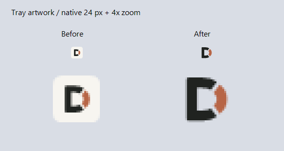

# Visual design and UI checks — alpha.7

The tray artwork now fills the available icon area without an opaque background plate. The original D geometry is retained; its square SVG canvas is `209 190 620 620`. The visible vector height is 572/620 (92.3%), compared with 572/1000 (57.2%) previously. The D counter and surrounding area are transparent.

This is a comparison of exported artwork on a sample background, not a capture of the Windows taskbar.

## Asset contract

| Role | Source | Appearance |
|---|---|---|
| EXE, shortcut, taskbar/title bar | `dialvia.ico`, `dialvia-icon.svg` | Ink D with copper accent; identical palette to the in-app mark, transparent background |
| Light taskbar tray | `dialvia-tray-light.ico` | Ink D with copper accent |
| Dark taskbar tray | `dialvia-tray-dark.ico` | Ivory D with lighter copper accent |
| In-app header | `dialvia-mark.svg`, `dialvia-mark-256.png` | Ink/copper on the paper UI |
| Dark mark for reuse | `dialvia-mark-dark.svg` | Ivory/copper; transparent |

Each ICO contains 32-bit native frames at **16, 20, 24, 30, 32, 36, 40, 48, 60, 64, 72, 80, 96, 128, 256** pixels; PNG exports include those sizes and 512. The manifest records role, canvas and size names. SVGs have an accessible title. Never flatten these icons onto a rounded square or add padding when regenerating assets.

The tray chooses its native frame from the primary taskbar DPI, reads `SystemUsesLightTheme` without changing Windows settings, and refreshes on preference/display changes. The shell and main window use the standard ink/copper brand. Notification-area primary contrast is checked separately for its light and dark variants against matching sample backgrounds; this does not claim visibility of the static shell icon on every possible surface. Installation issues a targeted shell item update for its own EXE/shortcut; it does not restart Explorer or clear global caches.

## Taskbar mismatch regression

Alpha.6 accidentally generated `dialvia.ico` with copper for both vector paths, while the in-app header used ink/copper. The user's taskbar screenshot exposed the mismatch. Alpha.7 restores ink/copper for the EXE, default window icon and shortcuts. Geometry and transparency are unchanged.

`Test-WindowsIcons.ps1` extracts the native shell icons from the built EXE and renders them with Windows `DrawIconEx`, along with four embedded window sizes and the two tray variants. All 8 renders must contain their expected primary/accent colors and retain clear corners. The old EXE failed with zero ink pixels in its shell icon; the corrected EXE passes. This checks the actual binary resources, not only source PNGs.

## UI inspection

| Surface | Inspected states / changes |
|---|---|
| Overview, bindings, voice, integration | Normal and minimum window sizes; readable wrapping, accessible input names, state-dependent Save, disabled/focus colors |
| Binding table/editor | Responsive columns, long-title/path tooltips, populated project/session fixtures, fixed action bar, Cancel/Esc and Chinese invalid-input message |
| Settings keyboard | Ctrl+S saves changed fixture settings; Esc closes the window, while an open dropdown handles Esc itself |
| Session browser | Recent, empty and index-error states; no-action buttons disabled when empty; wrapping footer; dropdown keyboard handling |
| Packaging | Matching version labels, embedded shell/light-tray/dark-tray/brand resources, regenerated public screenshots and install materials |

`Test-Brand.ps1` validates 45 ICO frames and 3 SVGs, including pixel dimensions, PNG source matching, transparent corners/counter, no plate, occupied bounds and matching-background tray contrast. Shell PNGs must match the in-app/light-tray brand at every native size, and the shell SVG must retain both ink and copper. Native Windows frame selection is checked through 128 px; the 256 px PNG data is checked directly because .NET Framework may select a smaller frame for a 256 px Icon request. Runtime tray requests are at most 64 px.

`Test-UI.ps1` captures 13 states with fictional data and records dimensions, actual graphics DPI, missing input names and horizontal flow overflow. This local pass used 144 graphics DPI (Windows 150%). Native fixture interaction also checked the four settings pages, invalid save, cancel/Esc, dropdown Esc, dirty/save state and Ctrl+S. Automated layout checks are deliberately narrow; visual inspection supplies the rest. Neither fixture mode touches personal settings or hardware.

The main application remains a light, System-DPI-aware WinForms UI. High-contrast color fallbacks are present but were not accepted on a live high-contrast desktop. Mixed-DPI monitor movement, every Windows theme and full assistive-technology navigation remain unverified. This is not a claim of complete WCAG or Windows certification. Existing handset acceptance and pending submission/notification tests remain in [validation](validation.md).

Microsoft references: [app icon construction](https://learn.microsoft.com/en-us/windows/apps/design/iconography/app-icon-construction) recommends transparent backgrounds and exact-size assets; [notification area](https://learn.microsoft.com/en-us/windows/win32/shell/notification-area) describes native tray integration. This unpackaged Win32 app uses multi-frame ICO resources, not MSIX target-size file naming.
